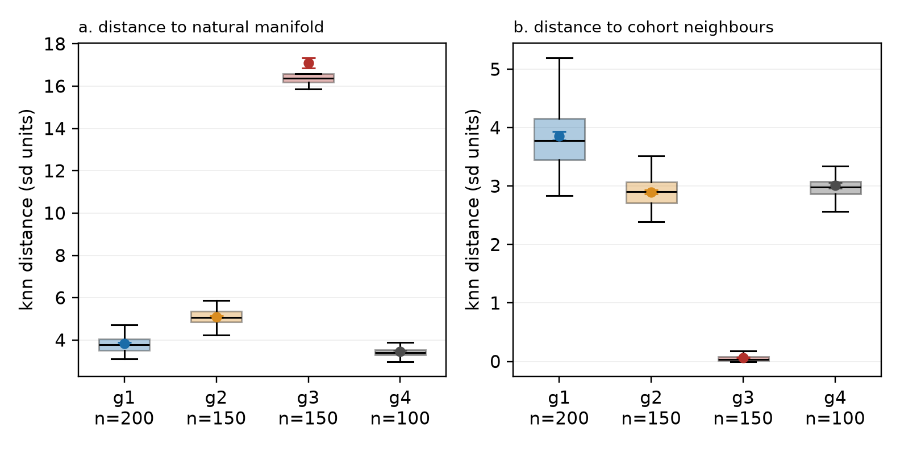
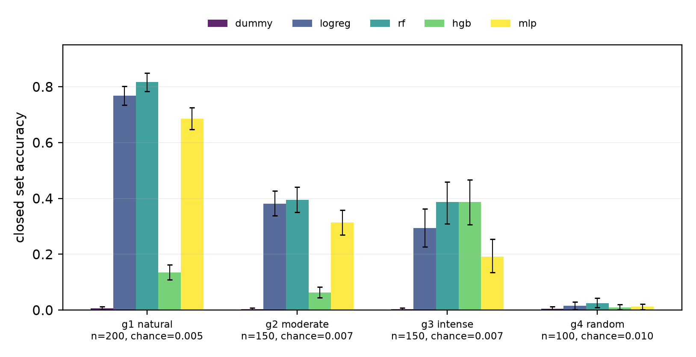
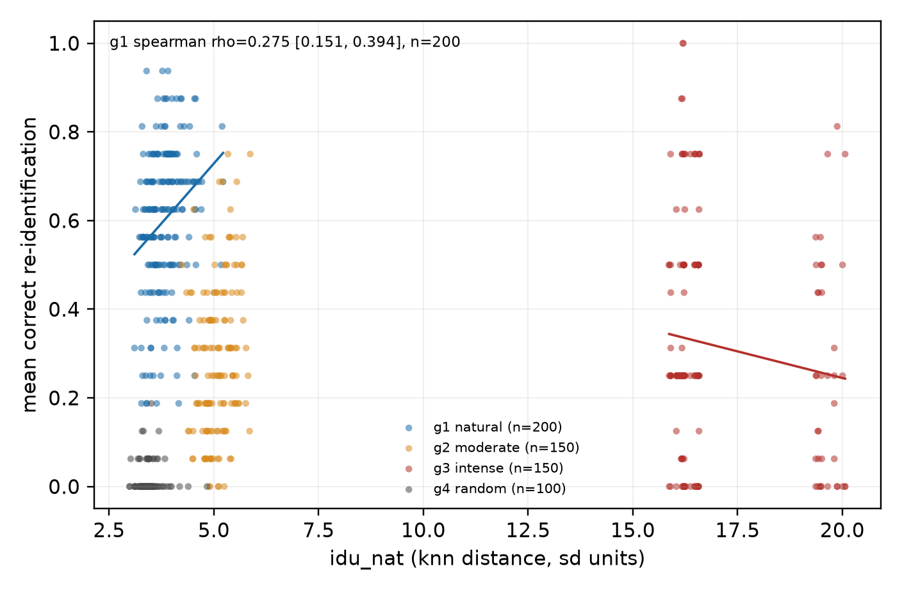
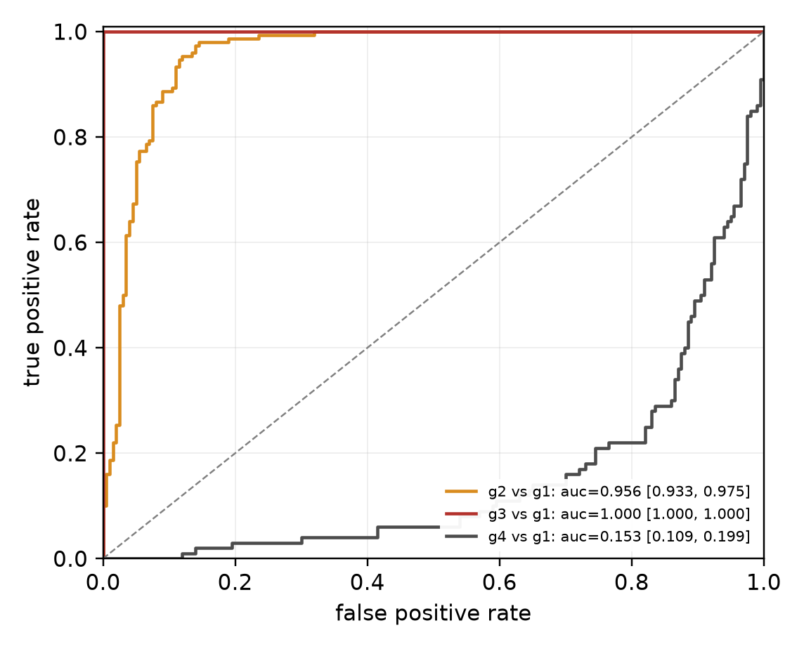
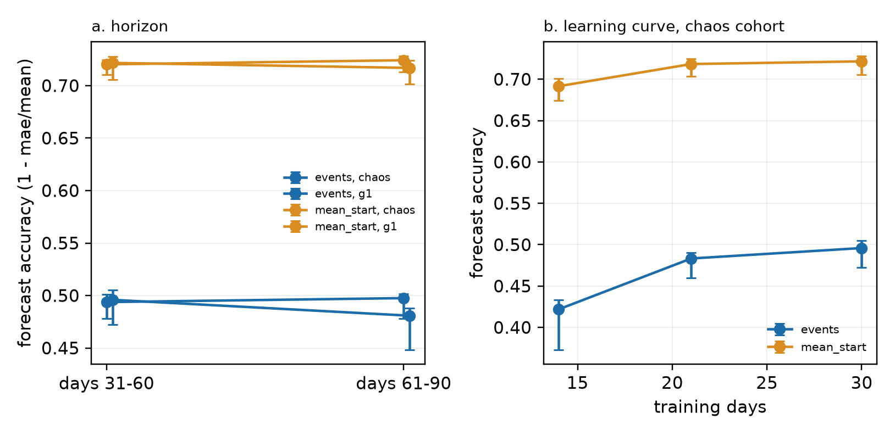
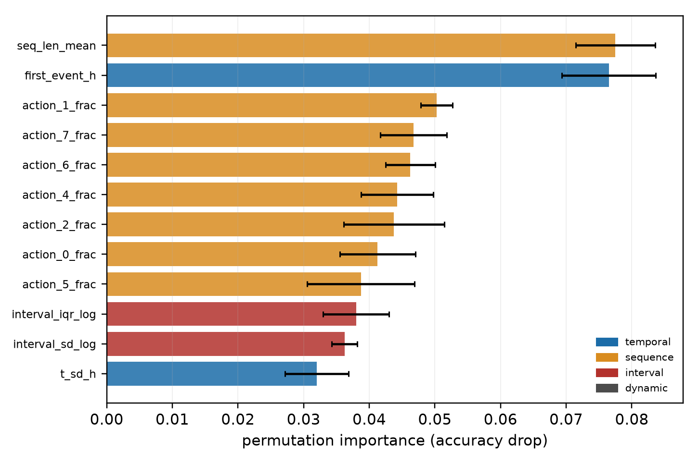
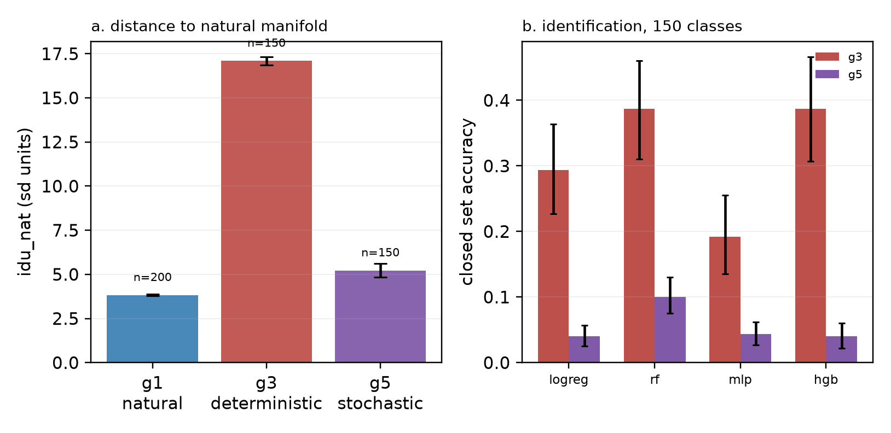
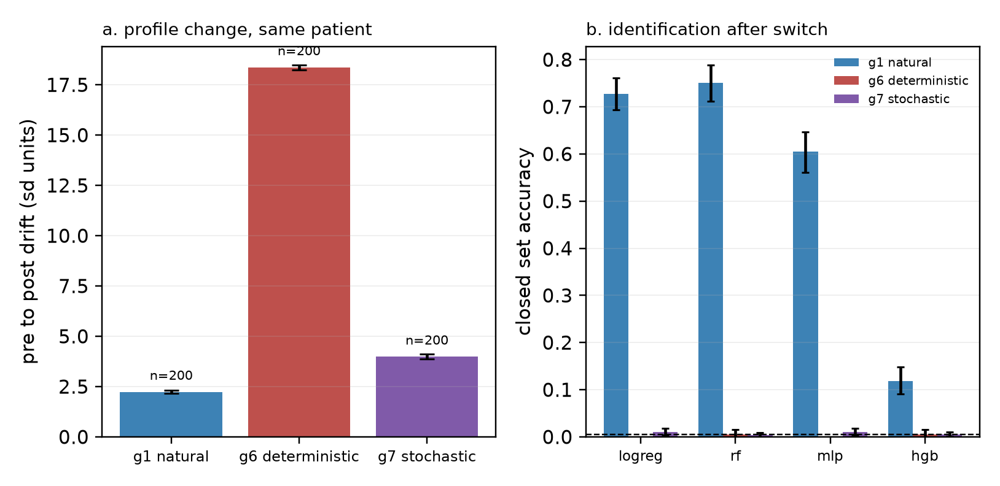

# аномальность без уникальности: детерминированная маскировка в синтетической когорте 600 пациентов

author: исследовательский проект eidolon
date: 2026-10-30
status: preprint draft, not peer reviewed
repo: локальный артефакт, public deposit pending; см PROVENANCE.md

## аннотация

проверялась гипотеза, что интенсивная техническая маскировка цифрового поведения создаёт плоский rank-1 профиль, который парадоксально легче обнаружить как аномалию, чем естественную биологическую вариативность. построен детерминированный генератор на c99: 600 виртуальных пациентов, 90 дней, 24 скрытых параметра, 1 991 067 событий. четыре основные группы: естественное поведение (n=200), умеренная маскировка (n=150), интенсивная детерминированная маскировка (n=150), ежедневно перерандомизированный контроль (n=100), плюс exploratory группа g5 (n=150) с теми же интенсивными параметрами и натуральным стохастическим эмиттером. признаки: 51 поведенческий показатель в окнах по 10 дней. идентификация: closed-set для 100, 150 и 200 классов, пять моделей, кластерный bootstrap по пациентам. уникальность: расстояние до 10 ближайших соседей внутри когорты. аномальность: расстояние до естественного многообразия и isolation forest, обученный только на естественной обучающей выборке.

результат смешанный. расстояние до естественного многообразия растёт: 3.825, 5.084, 17.096 и 3.449 для g1..g4. уникальность внутри когорты падает: 3.858, 2.900, 0.065 и 3.009; g3 коллапсирует в 58 уникальных векторов на 600 тестовых окон, максимальная коллизия 16. точность повторной идентификации: random forest 0.818 [0.784, 0.850] для g1, 0.395 [0.350, 0.442] для g2, 0.387 [0.310, 0.460] для g3, 0.025 [0.010, 0.043] для g4; chance 0.005, 0.0067, 0.0067 и 0.010. строгий порядок g1 > g2 > g3 не выполнен, но причина иная: per-model тесты разнонаправлены. logistic regression и mlp дают g2 > g3 (p_holm 3.3e-5 и 4.7e-8), hist gradient boosting даёт g3 > g2 (p_holm 2.3e-5), random forest не различает (p=0.112). среднее по моделям p=0.870 не является тестом неразличимости. аномалия g3 против g1 достигает auc 1.000 [1.000, 1.000], но тот же результат даёт один признак регулярности, например interval_cv. rank-1 на наблюдаемых признаках опровергнут: participation ratio 2.380, доля первой компоненты 0.500. стохастическая интенсивная группа g5 с теми же аффинными параметрами, но натуральным эмиттером даёт 600 из 600 уникальных профилей, idu_cohort 3.407, anomaly auc 0.629 и rf top1 0.100 [0.075, 0.130]; коллапс g3 связан с детерминированным эмиттером, а не с интенсивностью параметров. within-subject переключение даёт drift 2.238, 18.372 и 3.989 и ломает pre-to-post перенос: natural control rf top1 0.751 [0.711, 0.789], детерминированная маска 0.005, стохастическая 0.004 при chance 0.005. внутри маскированной области детерминированная маска сжимает 200 пациентов в 17 шаблонов с top1 0.085, 17x chance, а стохастическая оставляет 800 уникальных профилей, но in-domain top1 1-4x chance из за концентрации маскированных параметров (s в [0.30, 0.64] против равномерного [0, 1]). прогноз следующего дня не имеет within-patient skill: r2 отрицательный, accuracy 0.496 [0.472, 0.505] для chaos на днях 31-60 и 0.481 [0.448, 0.488] на днях 61-90, различие p=0.172.

вывод: детерминированная маскировка делает профиль аномальным и легко обнаружимым, но не уникальным; она превращает индивидуальный след в шаблон. стохастическая интенсивная маскировка с теми же параметрами такого коллапса не даёт: профили уникальны, аномальность умеренная, top1 падает до 0.100. сильная формулировка парадокса относится к детерминированному режиму, а не к маскировке вообще. подтверждены только отдельные компоненты: рост аномальности в детерминированном режиме, снижение идентифицируемости относительно естественной группы и малая положительная связь уникальности с идентифицируемостью внутри естественной группы. within-subject переключение подтверждает последнее: natural control rf top1 0.751, после детерминированной маски 0.005, после стохастической 0.004.

ключевые слова: цифровая анонимность, повторная идентификация, синтетическая когорта, поведенческая биометрия, аномалия, воспроизводимость.

## abstract (english)

we test the hypothesis that intense technical masking of digital behavior creates a flat rank-1 profile that is paradoxically easier to flag as an anomaly than natural biological variability. a deterministic c99 generator produced 600 synthetic patients, 90 days, 24 latent parameters and 1,991,067 events in four main groups: natural (n=200), moderate masking (n=150), intense deterministic masking (n=150), and a daily re-randomized control (n=100), plus an exploratory g5 group (n=150) with the same intense parameters and a natural stochastic emitter. we computed 51 behavioral features in 10-day windows and trained five closed-set models for 100 to 200 classes with patient-level cluster bootstrap. uniqueness was measured as the distance to the 10 nearest cohort neighbours; anomaly was measured as the distance to the natural manifold and an isolation forest trained on natural windows only.

the result is mixed. distance to the natural manifold rises from 3.825 to 5.084 to 17.096 across g1..g3, while within-cohort uniqueness falls from 3.858 to 2.900 to 0.065; g3 collapses into 58 distinct feature vectors over 600 test windows, with a largest collision of 16. random forest top1 accuracy is 0.818 [0.784, 0.850] for g1, 0.395 [0.350, 0.442] for g2, 0.387 [0.310, 0.460] for g3, and 0.025 [0.010, 0.043] for g4; chance is 0.005, 0.0067, 0.0067, and 0.010. the strict order g1 > g2 > g3 is not supported, but per-model tests disagree in direction: logistic regression and mlp give g2 > g3 (p_holm 3.3e-5 and 4.7e-8), hist gradient boosting gives g3 > g2 (p_holm 2.3e-5), and random forest does not separate them (p=0.112). the average across models p=0.870 is not a test of indistinguishability. anomaly auc for g3 against g1 is 1.000, but a single regularity feature such as interval_cv also reaches auc 1.000. the preregistered rank-1 criterion is refuted on observed features: participation ratio 2.380 and first-component share 0.500. a stochastic intense group g5, with the same affine parameters but natural stochastic emission, yields 600 of 600 distinct profiles, idu_cohort 3.407, anomaly auc 0.629 and rf top1 0.100 [0.075, 0.130]; the g3 collapse is tied to the deterministic emitter, not to parameter extremity. a within-subject switch gives drift 2.238, 18.372 and 3.989 and breaks pre-to-post transfer: natural-control rf top1 0.751 [0.711, 0.789], deterministic mask 0.005, stochastic mask 0.004 at chance 0.005. inside the masked domain the deterministic mask collapses 200 patients into 17 templates with top1 0.085, 17x chance, while the stochastic mask keeps 800 unique profiles but in-domain top1 at 1-4x chance because mask parameters concentrate (s in [0.30, 0.64] against uniform [0, 1]). next-day forecasts have negative within-patient r2; chaos accuracy is 0.496 [0.472, 0.505] for days 31-60 and 0.481 [0.448, 0.488] for days 61-90, p=0.172.

conclusion: deterministic masking in this construction produces an anomalous, easily detected template but not a unique identity. stochastic intense masking with the same parameters does not collapse: profiles stay unique, anomaly is moderate, and top1 falls to 0.100. the strong form of the paradox applies to the deterministic regime, not to masking in general. only anomaly growth in the deterministic regime, lower identifiability relative to natural behavior, and a small positive uniqueness-identifiability association within the natural group are supported. the within-subject switch breaks pre-to-post transfer for both masks; inside the masked domain the deterministic mask leaves 17x chance through templates and the stochastic mask 1-4x chance.

keywords: digital anonymity, re-identification, synthetic cohort, behavioral biometrics, anomaly detection, reproducibility.

## 1. введение

цифровой след пациента в медицинских информационных системах содержит не только прямые идентификаторы, но и совокупность временных, последовательностных и интервальных признаков. удаление имени не устраняет этой совокупности. поведение пациента в информационной среде имеет собственную структуру: информационная культура пациента выделена как многокомпонентный фактор (этико-правовый, профилактический, ургентный, социальный, культура использования источников) с сильной связью с результативностью медицинской помощи, корреляция +0.8 [угланова, мушников, костин и др., 2010], а источники, из которых пациенты и студенты-медики получают медицинскую информацию, преимущественно цифровые [угланова, мушников, поляков, 2020]. классические результаты повторной идентификации показывают, что разреженные наборы данных допускают восстановление личности по небольшому числу точек [narayanan, shmatikov, 2008], а k-анонимность не защищает от атак связывания [sweeney, 2002]. дифференциальная конфиденциальность задаёт формальную границу утечки [dwork, 2006], но не описывает, как именно бытовая маскировка меняет наблюдаемый профиль.

исходная гипотеза проекта eidolon состоит в том, что техническая маскировка создаёт детерминированный профиль с низкой эффективной размерностью, и этот профиль парадоксально легче обнаружить как аномалию, чем естественную вариативность. теоретическая линия опирается на три наблюдения. первое: попытка структурировать данные снижает энтропию и делает профиль заметным для детекторов аномалий [shannon, 1948]. второе: человеческое поведение обладает самоподобием и длинной памятью, которых лишены простые генераторы шума [mandelbrot, 1982]. третье: статистическая сингулярность сама становится маркером критического события [taleb, 2007]. инженерным аналогом служит проект proteus: в нём биологическое чтение порта оказалось rank-1 функционалом, а тайминг не зависел от режима [proteus, 2026, FINAL.md, N3, N9]. это не медицинские данные, но это демонстрация того, как сложная модель сворачивается в одномерный выход.

гипотезы h1..h7 зарегистрированы до генерации данных в `hypotheses.md` (2026-10-30T16:39:05Z). h1: расстояние до естественного многообразия растёт от g1 к g3. h2: точность идентификации падает от g1 к g2 к g3. h3: g3 отделяется от g1 как аномалия с auc не ниже 0.80. h4: внутри g1 уникальность положительно связана с идентифицируемостью. h5: в chaos когорте точность прогноза падает с ростом горизонта. h6: g3 имеет participation ratio ниже 2.0 и долю первой компоненты выше 0.80. h7: контроль g4 не превышает chance.

вклад работы: (1) детерминированный генератор и csv контракт, пригодные для битвайз реплея; (2) 51 поведенческий признак и две разные метрики, аномальность и уникальность; (3) честный набор отрицательных результатов, включая опровержение rank-1 и отсутствие прогностического skill; (4) воспроизводимый артефакт с manifest и хешами.

## 2. связанные работы

повторная идентификация по косвенным признакам описана для просмотров веб-страниц и социальных графов [narayanan, shmatikov, 2008], для браузерных отпечатков [eckersley, 2010], для динамики клавиатурного ввода [monrose, rubin, 1997] и для физических отпечатков устройств [kohno et al., 2005]. медицинские информационные системы добавляют временные метки, последовательности разделов и интервалы, которые в совокупности могут работать как поведенческий идентификатор.

k-анонимность формализует неразличимость внутри группы [sweeney, 2002]. дифференциальная конфиденциальность ограничивает влияние одной записи на результат запроса [dwork, 2006]. обе рамки предполагают, что защита достигается организацией данных, а не отдельным действием пользователя. настоящая работа проверяет противоположный сценарий: пользователь меняет собственное поведение, а не механизм публикации.

фрактальная структура поведения и тяжелые хвосты мотивируют использовать показатели вариативности и размерности [mandelbrot, 1982]. детекторы аномалий рассматривают редкое событие как сигнал [taleb, 2007]. рекурсивное обучение на сгенерированных данных может усиливать артефакты и терять исходный сигнал [shumailov et al., 2023]; поэтому синтетический эксперимент должен явно отделять свойства генератора от свойств реального поведения.

## 3. методы

### 3.1 дизайн и конфликт протокола

исходный протокол содержит два несовместимых числа: 500 пациентов в одном разделе и 200+150+150+100=600 в детальных группах. принято 600, поскольку размеры групп задают мощность парных сравнений. все отчёты содержат фактические n. наблюдение 90 дней. окно анализа 10 дней, девять окон на пациента. обучение: окна 1-5, дни 1-50. тест: окна 6-9, дни 51-90. окна одного пациента зависимы, поэтому доверительные интервалы строятся кластерным bootstrap по пациентам.

### 3.2 генератор

генератор написан на c99, компилируется с `-std=c99 -pedantic -Wall -Wextra -Werror -O2 -ffp-contract=off`, использует только xorshift64* и стандартную математику. сид задаётся только из командной строки. каждый пациент имеет 24 скрытых параметра (таблица 1). естественная группа использует марковскую цепь действий, логнормальные интервалы, циркадный и недельный ритм, тяжелые хвосты и сумму трех ar(1) процессов как приближение 1/f фактора. умеренная группа сжимает параметры к среднему и добавляет шум в действия, интервалы, время и длительность. интенсивная группа строит все 24 параметра как аффинную функцию одного s и генерирует детерминированный квантованный поток без обращений к rng. контроль g4 каждый день заново выбирает натуральные параметры, сохраняя маргиналы, но не устойчивую идентичность. пятая группа g5 добавлена как exploratory sensitivity после основного анализа: те же 24 аффинных параметра, что у g3, но натуральный стохастический эмиттер. g5 не входит в пререгистрированные h1..h7 и служит контрфактом для проверки, является ли коллапс g3 свойством детерминированного эмиттера или интенсивных параметров. для причинной проверки добавлена within-subject когорта: 200 natural control, 200 g6 с детерминированной маской и 200 g7 со стохастической маской. у g6 и g7 один и тот же пациент ведёт себя естественно дни 1-45 и маскированно дни 46-90; маска строится из его собственных 24 параметров через скаляр s, равный среднему нормализованных параметров.

**таблица 1. 24 скрытых параметра генератора.**

| # | параметр | диапазон | роль |
|---|---|---|---|
| 1 | t_first_mean | 5..11 ч | среднее время первого обращения |
| 2 | t_last_mean | 17..23 ч | среднее время последнего обращения |
| 3 | t_sd_min | 15..120 мин | вариабельность времени |
| 4 | dur_mean_s | 120..900 с | длительность сессии |
| 5 | dur_cv | 0.10..0.70 | вариабельность длительности |
| 6 | sessions_mean | 1.0..3.5 | число сессий в сутки |
| 7 | n_actions_mean | 6..25 | число действий |
| 8 | seq_persistence | 0.50..0.90 | вероятность повтора действия |
| 9 | repeat_prob | 0.05..0.35 | вероятность немедленного повтора |
| 10 | transition_temp | 0.5..2.0 | температура выбора действия |
| 11 | seq_len_cv | 0.10..0.50 | вариабельность длины |
| 12 | backtrack_prob | 0.02..0.30 | возврат к предыдущему разделу |
| 13 | interval_mean_ms | 1500..25000 | средний интервал |
| 14 | interval_sd_log | 0.25..0.90 | логнормальный разброс |
| 15 | interval_cv | 0.30..1.10 | коэффициент вариации |
| 16 | burstiness | 0.0..0.45 | вероятность коротких и длинных пауз |
| 17 | circadian_amp | 0.2..1.0 | амплитуда недельного времени |
| 18 | weekly_amp | 0.0..0.4 | недельная модуляция сессий |
| 19 | drift_rate | -0.01..0.01 | дрейф активности |
| 20 | stability | 0.60..0.95 | устойчивость |
| 21 | noise_level | 0.10..0.40 | шум времени |
| 22 | fractal_alpha | 0.60..0.95 | память 1/f фактора |
| 23 | anomaly_rate | 0.002..0.020 | вероятность аномалии |
| 24 | weekend_shift | -0.30..0.30 | сдвиг выходного дня |

csv контракт заморожен: `patient_id,group,day,t_s,action_seq,interval_ms,session_dur_s,action_id,section_id,is_repeat,session_idx,day_of_week,is_weekend`. все поля целые. группа 1, 2, 3, 4 соответствует natural, moderate, intense, random. все колонки и единицы описаны в `README.md`.

детерминизм проверен двумя прогонами с сидом 20261030: файлы идентичны, sha256 `7841bd667c35ee437eea9d1c58016990c081ed022d8f042389fb356b487ce1a9`. g3 не использует rng, поэтому его данные инвариантны к сиду; это явно указано в ограничениях.

### 3.3 признаки

для каждого окна вычислены 51 признак в четырёх категориях. временные: среднее и стандартное отклонение времени, круговая концентрация, первое и последнее событие, сессии в день, сдвиг выходного дня, доли ночных, утренних и вечерних событий. последовательностные: энтропия действий и переходов, доля самопереходов, повторов и возвратов, число уникальных действий, длина серии, энтропия разделов, доли каждого из восьми действий. интервальные: логарифмическое среднее, медиана, стандартное отклонение, cv, iqr, асимметрия, автокорреляция первого порядка, доли коротких и длинных интервалов, коэффициент burstiness. динамические: число событий и сессий, среднее и стандартное отклонение суточной активности, cv, тренд, higuchi fd, доля пропущенных дней, устойчивость, стандартное отклонение времени старта.

### 3.4 аномальность и уникальность

используются две разные конструкции, которые нельзя смешивать.

idu_nat: среднее расстояние до k=10 ближайших окон естественной обучающей выборки в пространстве 20 главных компонент после стандартизации и whitening. это мера удалённости от естественного многообразия, или аномальность.

idu_cohort: среднее расстояние до k=10 ближайших окон других пациентов в том же пространстве. это мера уникальности внутри когорты.

anomaly: отрицательный score isolation forest, обученного только на естественных обучающих окнах. auc считается на уровне пациента, окна используются как sensitivity analysis. дополнительно проверены одномерные auc отдельных признаков, чтобы отделить многомерную аномалию от простого порога регулярности.

### 3.5 идентификация

closed-set классификация внутри каждой группы: 200 классов для g1, 150 для g2, g3 и g5, 100 для g4. пять моделей: dummy, logistic regression, random forest, hist gradient boosting, mlp. g5 оценивается отдельно, как exploratory контроль, а не в основном сравнении h1..h7. дополнительно выполнен matched анализ на 150 классах: g1 урезан до 150 пациентов, g2 и g3 уже имеют 150; один primary classifier выбран на валидации g1. обучение на окнах 1-5, тест на окнах 6-9. метрики: accuracy, balanced accuracy, macro f1, top5, macro ovr auc. доверительные интервалы: кластерный bootstrap по пациентам, 2000 ресэмплов. chance равен 1/число классов и приведён в таблицах.

per-group дизайн выбран потому, что общая модель на 600 классов может использовать принадлежность к группе как тривиальный признак и смешивать идентификацию личности с детекцией режима. per-group задача отвечает на вопрос, различает ли модель пациентов внутри одного поведенческого режима. в within-subject анализе обучение идёт на окнах 1-4, дни 1-40, тест на окнах 6-9, дни 51-90; окно 5, дни 41-50, исключено, потому что пересекает переключение. 200 классов, chance 0.005. дополнительно измеряется drift между центроидом pre и post в pca пространстве, обученном на natural pre окнах.

### 3.6 прогноз

задача: предсказать суточное число событий и среднее время старта следующего дня по предыдущим семи дням. признаки строго лаговые: lag1..lag7, скользящее среднее и стандартное отклонение за 7 дней, сессии и средний интервал предыдущего дня, sin и cos дня недели, среднее и стандартное отклонение пациента за обучающий период. заполнение пропусков использует только дни 1-30. модель ridge с alpha=1.0. обучение на днях 1-30, тест на 31-60 и 61-90. дополнительно chaos когорта из 100 пациентов с усилением вариативности после дня 30 (множители 1.5 и 2.2). отчёт включает accuracy = 1 - mae/mean, r2, within-patient r2 и skill относительно среднего пациента и persistence.

### 3.7 статистика

групповые сравнения: kruskal-wallis для трёх основных групп, pairwise mann-whitney с поправкой holm. эффекты: cohen d с bootstrap ci95, eta squared для kruskal-wallis. корреляции: spearman с bootstrap ci95. множественность: holm по 7 первичным тестам, а также внутри семейств. мощность: априорная для d=0.5, n=150, alpha=0.05/7 равна 0.947; достигнутая мощность для наблюдаемого d=-13.16 равна 1.0, но post hoc мощность приведена только для интерпретации. все числа сопровождаются n и ci95, где это применимо.

### 3.8 воспроизводимость

`make manifest` пишет `results/manifest.txt`: sha256 бинарника, каждого csv, json и png, компилятор, cflags, сид, версии python пакетов, хеш окружения, длительность replay и результат cmp. `make check` запускает два прогона и cmp. `requirements.txt` фиксирует numpy 2.5.4, pandas 3.1.0, scikit-learn 1.9.1, scipy 1.18.1, matplotlib 3.11.2. pytorch не использован; нейросеть это sklearn MLPClassifier. это отклонение от исходного стека зафиксировано в `paper/deviations.md`.

## 4. результаты

### 4.1 когорта

таблица 2 суммирует размеры и основные метрики. основная когорта содержит 1 991 067 событий: g1 200 пациентов и 709 756 событий, g2 150 и 535 612, g3 150 и 394 650, g4 100 и 351 049; среднее число событий на пациента 3548.8, 3570.7, 2631.0 и 3510.5. exploratory g5 добавлена отдельным файлом и содержит 554 257 событий, 3695.0 на пациента.

**таблица 2. когорта и основные метрики.**

| группа | n | окон | idu_nat | idu_cohort | anomaly, среднее |
|---|---|---|---|---|---|
| g1 natural | 200 | 800 | 3.825 | 3.858 | 0.438 |
| g2 moderate | 150 | 600 | 5.084 | 2.900 | 0.488 |
| g3 intense | 150 | 600 | 17.096 | 0.065 | 0.654 |
| g4 random | 100 | 400 | 3.449 | 3.009 | 0.415 |
| g5 stochastic intense | 150 | 600 | 5.223 | 3.407 | 0.478 |

idu_nat монотонно растёт от g1 к g3, но idu_cohort в g3 падает почти до нуля. g5 возвращается к уровню idu_nat 5.223 и idu_cohort 3.407, то есть к умеренной аномальности и естественной уникальности. это первое расхождение между аномальностью и уникальностью.

### 4.2 поведенческие профили

таблица 3 показывает средние и стандартные отклонения ключевых признаков. g3 имеет нулевую вариабельность интервалов, нулевую фрактальную размерность и нулевую суточную вариабельность. g1, g2, g4 и g5 сохраняют ненулевые значения. g4 близок к g1 по маргиналам, но не имеет устойчивой индивидуальной структуры. g5 сохраняет низкую вариабельность параметров g3, но получает натуральный шум эмиттера.

**таблица 3. поведенческие признаки по группам, mean ± sd.**

| признак | g1 | g2 | g3 | g4 | g5 |
|---|---|---|---|---|---|
| событий в окне | 394.9 ± 124.5 | 400.1 ± 101.8 | 292.3 ± 212.5 | 387.9 ± 84.8 | 407.1 ± 238.5 |
| сессий в день | 2.39 ± 0.55 | 2.43 ± 0.50 | 2.00 ± 0.82 | 2.36 ± 0.45 | 2.30 ± 0.67 |
| log среднего интервала | 9.33 ± 0.29 | 9.37 ± 0.18 | 8.76 ± 0.58 | 9.34 ± 0.11 | 9.13 ± 0.57 |
| cv интервалов | 0.833 ± 0.135 | 0.737 ± 0.102 | 0.000 ± 0.000 | 0.877 ± 0.088 | 0.793 ± 0.249 |
| энтропия действий | 1.848 ± 0.118 | 2.030 ± 0.028 | 1.940 ± 0.190 | 1.994 ± 0.049 | 2.004 ± 0.045 |
| higuchi fd | 1.001 ± 0.290 | 0.998 ± 0.294 | 0.000 ± 0.000 | 1.021 ± 0.293 | 0.980 ± 0.282 |
| суточный cv | 0.557 ± 0.122 | 0.576 ± 0.128 | 0.000 ± 0.000 | 0.624 ± 0.150 | 0.534 ± 0.136 |

рисунок 1 показывает распределения idu_nat и idu_cohort. панель a: g3 резко отделён от остальных. панель b: g3, наоборот, ближе всех к другим окнам, потому что его окна почти совпадают.



### 4.3 идентификация

таблица 4 и рисунок 2 суммируют closed-set accuracy. g1 достигает 0.818 [0.784, 0.850] у random forest и 0.769 [0.735, 0.803] у logistic regression. g2 и g3 падают до 0.395 [0.350, 0.442] и 0.387 [0.310, 0.460] у random forest. g4 остаётся около chance: 0.025 [0.010, 0.043] у random forest при chance 0.010; на втором сиде 0.0075 [0.000, 0.018]. hist gradient boosting недообучен на g1 и g2 (0.135 и 0.063), но достигает 0.387 на g3, что объясняется шаблонной структурой.

**таблица 4. closed-set accuracy, mean [ci95], кластерный bootstrap по пациентам.**

| группа | chance | dummy | logreg | rf | hgb | mlp |
|---|---|---|---|---|---|---|
| g1 | 0.005 | 0.006 [0.001, 0.013] | 0.769 [0.735, 0.803] | 0.818 [0.784, 0.850] | 0.135 [0.109, 0.163] | 0.686 [0.648, 0.725] |
| g2 | 0.0067 | 0.003 [0.000, 0.008] | 0.382 [0.338, 0.427] | 0.395 [0.350, 0.442] | 0.063 [0.045, 0.083] | 0.313 [0.270, 0.358] |
| g3 | 0.0067 | 0.003 [0.000, 0.008] | 0.293 [0.227, 0.363] | 0.387 [0.310, 0.460] | 0.387 [0.307, 0.467] | 0.192 [0.135, 0.255] |
| g4 | 0.010 | 0.005 [0.000, 0.013] | 0.015 [0.003, 0.030] | 0.025 [0.010, 0.043] | 0.010 [0.003, 0.020] | 0.013 [0.003, 0.023] |



g1 резко превосходит остальные группы. описательное среднее по четырём моделям равно 0.602, 0.288 и 0.315, но это не консенсус и не тест: per-model patient-level тесты разнонаправлены. logistic regression и mlp дают g2 > g3 (p_holm 3.3e-5 и 4.7e-8), hist gradient boosting даёт g3 > g2 (p_holm 2.3e-5), random forest не различает группы (p=0.112). среднее p=0.870 скрывает эти противоположные знаки и не является свидетельством неразличимости. строгая гипотеза h2 о монотонном падении g1 > g2 > g3 опровергнута, но не потому, что g2 и g3 равны, а потому, что направление различия зависит от модели. matched анализ на 150 классах, где g1 урезан до 150 пациентов, подтверждает эту гетерогенность: g1 0.820, g2 0.395, g3 0.387 у выбранного на валидации random forest, при этом logreg даёт 0.382 против 0.293, mlp 0.313 против 0.192, hgb 0.063 против 0.387.

**таблица 4b. per-model g2 против g3, patient level.**

| модель | g2 | g3 | разность g2-g3 | p_holm |
|---|---|---|---|---|
| logreg | 0.382 | 0.293 | +0.088 | 3.3e-5 |
| mlp | 0.313 | 0.192 | +0.122 | 4.7e-8 |
| hgb | 0.063 | 0.387 | -0.323 | 2.3e-5 |
| rf | 0.395 | 0.387 | +0.008 | 0.112 |

top5 accuracy для g3 равна 1.000 у random forest и hist gradient boosting и 0.900 у logistic regression. это означает, что истинный пациент почти всегда входит в пятерку кандидатов, хотя точный top1 ограничен коллизиями. g1 top5 0.955, g2 0.695, g4 0.078.

рисунок 3 связывает уникальность и идентифицируемость. внутри g1 положительная связь: spearman rho=0.275 [0.151, 0.394] для idu_nat и 0.387 для idu_cohort, p=1.5e-8. но объяснённая дисперсия мала: r2=0.076 для idu_nat. общая корреляция по всем группам равна 0.027 [−0.063, 0.117], p=0.512, потому что группы смешивают разные режимы.



### 4.4 аномалия

anomaly auc на уровне пациента: g2 0.956 [0.933, 0.975], g3 1.000 [1.000, 1.000], g4 0.153 [0.109, 0.199]. на уровне окон: 0.901 [0.878, 0.922], 1.000 и 0.250 [0.215, 0.284]. g4 ниже 0.5, то есть по anomaly score выглядит естественнее g1.

однако auc 1.0 не является свидетельством сложной rank-1 сигнатуры. десять отдельных признаков дают auc 1.0 между g1 и g3: t_sd_h, t_circ_r, sessions_sd, self_transition_rate, repeat_rate, backtrack_rate, seq_len_sd, interval_sd_log, interval_cv, interval_iqr_log. любой порог по interval_cv или higuchi fd разделяет группы идеально. многомерная аномалия здесь эквивалентна детекции регулярности и квантования.



### 4.5 уникальность и коллизии

g3 содержит 600 тестовых окон и только 58 уникальных векторов признаков после округления до шести знаков. максимальная коллизия 16 окон, медианная 12, доля уникальных профилей 0.0967. это оконная величина, а не потолок top1. потолок top1 при точном шаблонном совпадении равен 58/150=0.3867. random forest и hist gradient boosting дают ровно 0.3867, то есть достигают этого потолка; остаточного индивидуального сигнала выше точного профиля нет. logistic regression 0.293 и mlp 0.192 ниже потолка из за ошибки модели. вывод: идентификация g3 полностью ограничена шаблоном, а не индивидуальной подписью.

held-out reference, обученный на 100 пациентах g1, даёт те же направления: idu_nat 4.10 для оставшихся 100 g1, 5.29 для g2, 16.51 для g3, 3.67 для g4. это снижает риск того, что эффект создан только совпадением референсной и тестовой выборок.

### 4.6 rank-1

пререгистрированная метрика h6 не выполнена: participation ratio 2.380, доля первой компоненты 0.500 при порогах ниже 2.0 и выше 0.80. post hoc анализ на ранговых корреляциях даёт 2.155 и 0.666, также ниже порогов. второй сид даёт 2.381 и 0.519. вывод: латентные 24 параметра g3 построены как аффинная функция одного s, но 51 наблюдаемый признак не является линейно rank-1. корректная формулировка: low-dimensional, примерно двумерный, не rank-1.

### 4.7 прогноз

таблица 5 и рисунок 4. g1 events accuracy 0.494 [0.478, 0.501] на днях 31-60 и 0.498 [0.478, 0.502] на днях 61-90. g2 0.483 [0.464, 0.490] и 0.486 [0.469, 0.495]. g4 0.448 [0.423, 0.463] и 0.437 [0.416, 0.450]. g3 1.000, потому что суточное число событий постоянно. агрегированная chaos accuracy 0.496 [0.472, 0.505] и 0.481 [0.448, 0.488]; парная разность на уровне пациентов 0.489 против 0.469 даёт 0.0204 [−0.0049, 0.0446], p=0.172, dz=0.160. chaos mean_start 0.722 и 0.717, p=0.285.

within-patient r2 отрицательный во всех недетерминированных группах: g1 −0.118 и −0.159, chaos −0.119 и −0.169. skill относительно среднего пациента также отрицательный: −0.012 и −0.032. модель предсказывает не динамику, а среднее; accuracy 0.49 для events означает, что mae составляет половину среднего. это не skill score. h5 опровергнута, claim о пределе долгосрочного прогнозирования снят.

**таблица 5. прогноз next-day, accuracy = 1 - mae/mean.**

| когорта | target | дни 31-60 | дни 61-90 | within r2, 31-60 | within r2, 61-90 |
|---|---|---|---|---|---|
| g1 | events | 0.494 [0.478, 0.501] | 0.498 [0.478, 0.502] | −0.118 | −0.159 |
| g2 | events | 0.483 [0.464, 0.490] | 0.486 [0.469, 0.495] | −0.143 | −0.111 |
| g3 | events | 1.000 | 1.000 | 1.000 | 1.000 |
| g4 | events | 0.448 [0.423, 0.463] | 0.437 [0.416, 0.450] | −0.123 | −0.107 |
| chaos | events | 0.496 [0.472, 0.505] | 0.481 [0.448, 0.488] | −0.119 | −0.169 |
| chaos | mean_start | 0.722 [0.706, 0.728] | 0.717 [0.701, 0.724] | −0.099 | −0.121 |



### 4.8 важность признаков

таблица 6 и рисунок 5. для g1 наибольший permutation importance у seq_len_mean 0.0775 ± 0.0061, first_event_h 0.0765 ± 0.0071, action_1_frac 0.0503 ± 0.0024, action_7_frac 0.0468 ± 0.0050, action_6_frac 0.0463 ± 0.0038, action_4_frac 0.0443 ± 0.0055, action_2_frac 0.0438 ± 0.0077; далее interval_iqr_log 0.0380 ± 0.0050, interval_sd_log 0.0363 ± 0.0019 и t_sd_h 0.0320 ± 0.0048. суммарно sequence 0.446, temporal 0.113, interval 0.091, dynamic отрицательный −0.012 из за коррелированных признаков. для g3 permutation importance около нуля, потому что модель использует шаблоны и признаки дублируются; impurity importance выделяет first_event_h 0.051, t_circ_r 0.105, t_mean_h 0.109.

**таблица 6. top 10 permutation importance для g1.**

| признак | категория | importance ± sd |
|---|---|---|
| seq_len_mean | sequence | 0.0775 ± 0.0061 |
| first_event_h | temporal | 0.0765 ± 0.0071 |
| action_1_frac | sequence | 0.0503 ± 0.0024 |
| action_7_frac | sequence | 0.0468 ± 0.0050 |
| action_6_frac | sequence | 0.0463 ± 0.0038 |
| action_4_frac | sequence | 0.0443 ± 0.0055 |
| action_2_frac | sequence | 0.0438 ± 0.0077 |
| interval_iqr_log | interval | 0.0380 ± 0.0050 |
| interval_sd_log | interval | 0.0363 ± 0.0019 |
| t_sd_h | temporal | 0.0320 ± 0.0048 |



### 4.9 контроль и репликация

g4 на основном сиде даёт random forest 0.025 [0.010, 0.043] при chance 0.010. на уровне окон p=0.0078, holm по пяти моделям 0.039. на уровне пациентов 9 из 100 имеют хотя бы одно верное окно против ожидания 3.94, p=0.0174, holm по пяти моделям 0.087, holm по семи тестам 0.348. второй сид даёт 0.0075 [0.000, 0.018]. статус h7: неопределённый, не опровергнутый. устойчивого переобучения нет, но один сид даёт небольшой избыток.

репликация сида 20261031: idu_nat 3.845, 5.016, 16.735, 3.498 для g1..g4; logreg accuracy 0.801 [0.770, 0.833], 0.447 [0.400, 0.495], 0.293 [0.227, 0.363], 0.010 [0.003, 0.020]; rf 0.814 [0.781, 0.845], 0.412 [0.360, 0.463], 0.387 [0.310, 0.460], 0.0075 [0.000, 0.018]. g3 инвариантен к сиду по построению, поэтому его совпадение не является независимой репликацией.

### 4.10 вердикты гипотез

**таблица 7. вердикты h1..h7.**

| гипотеза | критерий | результат | p_holm по 7 | вердикт |
|---|---|---|---|---|
| h1 | idu_nat g3 > g2 > g1, d >= 0.8 | 3.825, 5.084, 17.096; d=-13.16 | 9.5e-94 | подтверждена как аномальность |
| h1b | idu_cohort g3 > g2 > g1 | 3.858, 2.900, 0.065 | n/a | опровергнута |
| h2 | accuracy g1 > g2 > g3 | per-model: logreg и mlp g2>g3, hgb g3>g2, rf tie; среднее 0.602, 0.288, 0.315 | 1.000 | опровергнута как строгий порядок, среднее по моделям не является тестом |
| h3 | anomaly auc g3 vs g1 >= 0.80 | 1.000 [1.000, 1.000] | 6.3e-57 | подтверждена, но тривиальна |
| h4 | rho idu и accuracy в g1 >= 0.20 | 0.275 [0.151, 0.394] | 0.00041 | подтверждена, малый эффект |
| h5 | chaos accuracy 31-60 > 61-90 | 0.496 против 0.481, p=0.172 | 0.517 | опровергнута |
| h6 | pr < 2.0, lambda1 > 0.80 | 2.380, 0.500 | 1.000 | опровергнута |
| h7 | g4 не выше chance + 2 sd | rf 0.025, patient p_holm 0.087 | 0.348 | неопределённая |

### 4.11 стохастическая интенсивная группа g5

чтобы отделить детерминированный эмиттер от интенсивности параметров, сгенерирована пятая группа: те же 24 аффинных параметра, что у g3, но события производятся натуральным стохастическим эмиттером с марковскими действиями, логнормальными интервалами и 1/f фактором. g5 содержит 150 пациентов и 600 тестовых окон. все 600 окон уникальны, доля уникальных профилей 1.000, потолок top1 1.000.

idu_nat g5 равен 5.223, то есть выше g2 5.084, но намного ниже g3 17.096. idu_cohort равен 3.407, то есть близок к g1 3.858 и g4 3.009, а не к g3 0.065. anomaly auc g5 против g1 равен 0.629, а не 1.000. random forest top1 равен 0.100 [0.075, 0.130], top5 0.413; logistic regression 0.040 [0.025, 0.057], mlp 0.043 [0.027, 0.062], hist gradient boosting 0.040 [0.022, 0.060]. participation ratio 1.944 и lambda1 share 0.692, то есть g5 ближе к низкоразмерному профилю, но всё ещё не проходит пререгистрированный порог rank-1.

интерпретация: интенсивные аффинные параметры сами по себе не создают ни коллапса уникальности, ни идеальной аномалии. их создаёт детерминированный квантованный эмиттер. g5 остаётся умеренно аномальным и хуже идентифицируемым, чем g1, но его профили уникальны. это ограничивает сильную формулировку парадокса детерминированным режимом. анализ exploratory, не входит в h1..h7 и не заменяет основной результат.



### 4.12 within-subject переключение

когорта содержит 200 natural control g1, 200 g6 и 200 g7. у g6 и g7 дни 1-45 естественные, дни 46-90 маскированные. g6 использует детерминированный эмиттер g3, g7 использует стохастический эмиттер. маска строится из собственных параметров пациента: скаляр s равен среднему 24 нормализованных параметров. g1 является независимым natural контролем, а не теми же пациентами; сравнение g6 и g7 between-subject, сравнение pre и post внутри каждой группы within-subject.

концентрация маски. из за усреднения 24 параметров s у g6 и g7 концентрируется: восстановленный из post событий диапазон [0.30, 0.64], среднее 0.4948, sd 0.0543, ширина квантовой ячейки 0.0208. у g3 и g5 s равномерен на [0, 1]. это эффект цпт: все маски похожи друг на друга, и это объясняет все три результата ниже.

drift между pre и post центроидами равен 2.238 [2.173, 2.303] для natural control, 18.372 [18.250, 18.487] для g6 и 3.989 [3.869, 4.119] для g7. детерминированная маска меняет профиль в восемь раз сильнее естественного дрейфа, стохастическая примерно в 1.8 раза.

pre-to-post перенос. классификатор обучен на natural окнах 1-4 и протестирован на маскированных 6-9: g1 0.751 [0.711, 0.789], g6 0.005 [0.000, 0.015], g7 0.004 [0.000, 0.009], chance 0.005. это тест переноса между областями, а не уничтожения идентичности: любая маска ломает перенос классификатора, обученного до маски. положительный контроль на тех же пациентах до маски: g6 pre-only logreg 0.5425 [0.490, 0.598], g7 pre-only 0.525 [0.470, 0.583].

post-only идентификация внутри маскированной области, обучение на окнах 6-7 и тест на 8-9:

**таблица 8. within-subject switch.**

| группа | drift | pre-only logreg | pre-to-post rf | post-only logreg | post-only rf | post профилей |
|---|---|---|---|---|---|---|
| g1 natural | 2.238 [2.173, 2.303] | 0.600 [0.550, 0.650] | 0.751 [0.711, 0.789] | 0.570 [0.520, 0.623] | 0.463 [0.410, 0.520] | 800 из 800 |
| g6 deterministic | 18.372 [18.250, 18.487] | 0.543 [0.490, 0.598] | 0.005 [0.000, 0.015] | 0.083 [0.045, 0.123] | 0.085 [0.050, 0.128] | 17 из 800 |
| g7 stochastic | 3.989 [3.869, 4.119] | 0.525 [0.470, 0.583] | 0.004 [0.000, 0.009] | 0.005 [0.000, 0.013] | 0.020 [0.008, 0.035] | 800 из 800 |

три результата. первый: детерминированная маска g6 сжимает 200 пациентов в 17 шаблонов, plurality ceiling 0.085, rf и hgb top1 равны 0.085, то есть 17x chance; топ1 маскированной идентичности ограничен шаблоном, не человеком. второй: стохастическая маска g7 оставляет 800 уникальных post профилей, но in-domain top1 на уровне 1-4x chance, потому что маскированные параметры всех пациентов концентрированы узким s: межпациентный разброс масок мал, а внутри-пациентная вариативность эмиттера велика. третий: pre-to-post перенос отсутствует у обеих масок.

post-mask метрики: g6 имеет idu_nat 16.24, idu_cohort 0.026 и anomaly auc 1.000 против g1; g7 имеет idu_nat 3.257, idu_cohort 2.611 и anomaly auc 0.067. anomaly score односторонний: двусторонний auc g7 равен 0.933, то есть детектор, помечающий и слишком регулярные, и слишком гладкие профили, отделяет g7 от g1. стохастическая маска не делает профиль неотличимым от natural, он просто смещён в другую сторону.

rank-1: на pre/post смеси g6 даёт participation ratio 1.553 и lambda1 0.771 на post окнах, что проходит порог h6, в отличие от g3 с 2.380 и 0.500. наблюдаемая размерность зависит от конструкции маски и состава окон; универсальный claim rank-1 не поддерживается.

интерпретация: маска разрушает перенос идентичности между областями, но не обязательно уничтожает информацию. детерминированная маска заменяет идентичность шаблоном с остаточной идентифицируемостью 17x chance; стохастическая маска при концентрированных параметрах снижает идентифицируемость до chance, но за счёт похожести масок между пациентами, а не за счёт индивидуальной непрозрачности. анализ exploratory, не входит в h1..h7.



### 4.13 open-set verification и обнаружимость маски

closed-set top1 отвечает на вопрос "кто из n пациентов это", но не на вопрос "новый это пациент или известный". open-set verification на парах окон: same-patient против different-patient, евклидово расстояние в стандартизованном 20-компонентном whitened pca пространстве, обученном на g1.

**таблица 7b. open-set verification, auc и eer.**

| группа | auc [ci95] | eer [ci95] |
|---|---|---|
| g1 | 0.894 [0.878, 0.909] | 0.178 [0.163, 0.195] |
| g2 | 0.689 [0.669, 0.711] | 0.368 [0.350, 0.385] |
| g3 | 0.993 [0.992, 0.995] | 0.0125 [0.0102, 0.0153] |
| g4 | 0.502 [0.486, 0.517] | 0.497 [0.483, 0.515] |
| g5 | 0.795 [0.782, 0.809] | 0.273 [0.258, 0.286] |
| g6 post | 0.951 [0.944, 0.957] | 0.0874 [0.0773, 0.0996] |
| g7 post | 0.558 [0.544, 0.571] | 0.455 [0.444, 0.468] |

auc g3 0.993 измеряет дубликацию окон, а не индивидуальную сигнатуру: внутри одного точного профиля все пары имеют нулевое расстояние, auc 0.5, eer 0.5, ни одна метрика не разделяет same и different пациентов внутри шаблона. g7 open-set auc 0.558 и eer 0.455 близки к g4 0.502 и 0.497: после стохастической маски same-patient пары почти неотличимы от different-patient.

обнаружимость маски: один признак interval_cv даёт auc 1.000 против g1 для g3 и g6. для стохастических масок ядро из трёх регулярных признаков даёт только 0.529 для g5 и 0.512 для g7, но action_entropy даёт 0.921 для g5 и 0.942 для g7. стохастическая маска снижает энтропию действий до g3 уровня 1.94-2.00 против g1 1.85 и потому обнаружима. эффективные классы: hill number порядка 2 равен 52.1 для g3 на 150 пациентов, 10.1 для g6 на 200; g5 и g7 сохраняют 150 и 200. чувствительность потолка: без temporal признаков потолок g3 падает до 0.32, на sequence-only до 0.053; потолок зависит от представления, rf использует все 51 признак, поэтому связывает только полный потолок 0.3867. калибровка anomaly: эмпирические p-values на held-out natural равномерны (ks p 0.765), platt-калиброванный g3 brier 0.0024.

сводка: детерминированная маска обнаружима порогом регулярности и сжимает эффективные классы в 3-20 раз; стохастическая маска скрывает индивидуальность в open-set смысле, но обнаружима падением энтропии действий.

## 5. обсуждение

### 5.1 аномальность без уникальности

центральный результат: детерминированная маскировка увеличивает расстояние до естественного многообразия и одновременно уменьшает уникальность внутри когорты. g3 далёк от естественных профилей, но близок к другим g3 профилям. это не парадокс уникальности, а парадокс шаблона: попытка исчезнуть переводит пациента в небольшой набор повторяющихся архетипов. детектор аномалий легко находит такой профиль, но индивидуальная идентификация внутри шаблона ограничена коллизиями. g5 показывает, что это свойство детерминированного эмиттера: те же интенсивные параметры с натуральным шумом дают 600 уникальных профилей и anomaly auc 0.629. within-subject переключение показывает, что перенос идентичности между областями отсутствует: top1 падает с 0.751 до 0.005 и 0.004. но внутри маскированной области детерминированная маска оставляет 17x chance через 17 шаблонов, а стохастическая 1-4x chance. маска ломает перенос, а не уничтожает информацию; остаточная идентифицируемость держится на шаблоне и на концентрации масок.

формулировка "информационный каннибализм" здесь уместна в узком смысле: 24 параметра сворачиваются в один s, а 51 наблюдаемый признак даёт 58 уникальных векторов. информация о личности не исчезает полностью, но становится грубой и повторяемой.

исходное ожидание протокола, что accuracy падает слегка, а индекс уникальности растёт, не подтверждено. accuracy падает примерно вдвое: 0.818 у g1 против 0.395 и 0.387 у g2 и g3. idu_cohort не растёт, а падает с 3.858 до 0.065. наблюдается не "uniqueness spike", а "anomaly spike" вместе с "uniqueness collapse". это главное расхождение между исходной теорией и данными.

### 5.2 неманотонная идентифицируемость

g1 резко отличается от g2 и g3, но соотношение g2 и g3 зависит от модели. logistic regression и mlp дают g2 > g3, hist gradient boosting даёт g3 > g2, random forest не различает. это означает, что умеренная маскировка уже разрушает большую часть индивидуального сигнала, а дальнейшее усиление не даёт однородного дополнительного снижения top1. шаблон g3 устойчив и в некоторых моделях легче запоминается, но это свойство конкретного классификатора и шаблонной структуры, а не монотонная доза маскировки. g5 с натуральным эмиттером падает до top1 0.100, то есть детерминированный шаблон g3 является основным источником остаточной идентифицируемости. within-subject переключение подтверждает отсутствие переноса на уровне одного человека: natural control 0.751, детерминированная маска 0.005, стохастическая 0.004; внутри маскированной области 0.085 и 0.005-0.020.

### 5.3 rank-1: латентный и наблюдаемый уровни

латентная конструкция g3 действительно аффинна одному s. однако линейная pca на 51 признаке даёт pr=2.38 и lambda1=0.50. g5 с теми же параметрами и натуральным шумом даёт pr=1.944 и lambda1=0.692, то есть ближе к низкоразмерному профилю, но всё ещё не проходит порог 0.80 по lambda1. причина в том, что признаки нелинейны по s и квантованы; одномерная кривая в 51-мерном пространстве может требовать нескольких линейных компонент. корректный вывод: латентный генератор rank-1, наблюдаемый профиль low-dimensional, но не rank-1. сильная формулировка исходной гипотезы на наблюдаемом уровне опровергнута.

### 5.4 прогноз и биологическая вариативность

одношаговый прогноз не имеет within-patient skill: r2 отрицательный, skill относительно среднего пациента отрицательный. chaos когорта показывает небольшое падение accuracy 0.496 до 0.481, но доверительный интервал включает ноль. это не доказательство предела долгосрочного прогнозирования, а демонстрация того, что суточная активность в данной модели плохо предсказуема. g3 предсказуем идеально, потому что детерминирован; это manipulation check, а не биологическое открытие.

### 5.5 последствия для приватности

практический вывод отличается от исходной теории. защита через маскировку поведения может сделать пользователя более заметным для детектора аномалий, но не делает его уникальным. риск состоит не в уникальности маскированного профиля, а в том, что маска сама является признаком: регулярность, квантование и отсутствие естественной вариативности выделяют группу. политика приватности должна ограничивать связывание данных и использование вторичных признаков, а не полагаться на поведенческую мимикрию. это согласуется с рамками k-анонимности и дифференциальной конфиденциальности [sweeney, 2002; dwork, 2006]. организационный слой дополнен работами ивановской школы: медико-организационные технологии работы с пациентами [мушников, поляков, куканова и др., 2009] и компоненты информационной культуры пациента [угланова, мушников, костин и др., 2010] дают основание для рекомендаций по цифровой гигиене, встроенных в существующие механизмы информирования пациентов, а не в отдельные технические требования к их поведению.

## 6. ограничения

1. данные синтетические. 24 параметра и марковская модель действий не являются биологической моделью; эффекты описывают генератор, а не реальных пациентов.
2. g3 детерминирован и не использует rng. его 58 уникальных профилей и top5=1.0 являются свойством конструкции. выводы о реальной маскировке ограничены.
3. g4 это daily re-randomized natural, а не чистый white noise из протокола. он сохраняет натуральные маргиналы и не является идеальным контролем для аномалии.
4. число классов и обучающих окон различается: g1 200 классов и 1000 окон, g2/g3 150 и 750, g4 100 и 500. сравнение top1 между группами ограничено этим. matched анализ на 150 классах подтверждает per-model гетерогенность g2/g3, но остаётся exploratory.
5. hist gradient boosting недообучен на g1 и g2; per-model результаты важнее среднего по моделям. среднее по четырём моделям не было пререгистрировано и скрывает противоположные знаки g2/g3. g5 добавлена после основного анализа и является exploratory.
6. idu_nat зависит от референсной выборки. held-out reference на 100 пациентах g1 сохраняет направления, но не устраняет конструктную зависимость.
7. rank-1 опровергнут на наблюдаемых признаках; латентная rank-1 конструкция не эквивалентна наблюдаемой.
8. прогноз одношаговый и не имеет within-patient skill; claim о долгосрочном пределе снят.
9. pytorch не использован, нейросеть это sklearn MLPClassifier. это отклонение от исходного стека.
10. основной сид один, репликация только для logreg и rf; hgb и mlp на втором сиде не запускались.
11. множественность: глобальная поправка holm по семи тестам проведена post hoc; h2, h5, h6, h7 после неё не значимы.
12. within-subject переключение проведено на синтетических данных и только для двух типов маски, детерминированной и стохастической. реальное переключение поведения не наблюдалось, поэтому причинный вывод ограничен генератором.

## 7. заключение

в основной синтетической когорте 600 пациентов интенсивная детерминированная маскировка создала профиль, который далёк от естественного многообразия и легко обнаруживается как аномалия, но не является уникальным. g3 коллапсирует в 58 шаблонов, top1 идентификация не превышает 0.387, top5 достигает 1.000. строгая версия парадокса, rank-1 аномальный и одновременно уникальный профиль, не подтверждена. стохастическая интенсивная группа g5 с теми же параметрами даёт 600 уникальных профилей, anomaly auc 0.629 и top1 0.100; коллапс является свойством детерминированного эмиттера, а не маскировки вообще. within-subject переключение даёт natural control top1 0.751 и pre-to-post перенос на chance для обеих масок; внутри маскированной области детерминированная маска оставляет 17x chance через шаблон, стохастическая снижает до 1-4x chance. маска разрушает перенос идентичности между областями; остаточная идентифицируемость держится на шаблоне, а не на человеке. подтверждены только рост аномальности в детерминированном режиме, снижение идентифицируемости относительно естественной группы и малая положительная связь уникальности с идентифицируемостью внутри естественной группы. практический вывод: детерминированная маскировка может быть маркером, но не защитой; приватность должна обеспечиваться ограничением связывания данных, а не поведенческой мимикрией.

## декларации

этика: исследование полностью синтетическое. реальные пациенты, диагнозы, имена, адреса и медицинские записи не использовались. юридическая деанонимизация личности не выполнялась и не утверждается.

доступность данных: все csv генерируются детерминированным кодом из `src/`. sha256 каждого файла, компилятор, cflags, сид и окружение записаны в `results/manifest.txt`. release archive: `release/eidolon-v1.3.0.tar.gz`. исходные документы в `refs/` не распространяются.

доступность кода: `src/`, `python/`, `tools/`, `tests/`, `Makefile`. лицензия кода MIT, лицензия статьи и синтетических данных CC BY 4.0, см. `LICENSE`, `LICENSE-CC-BY-4.0`, `NOTICE`.

пререгистрация: self reported, без внешней метки времени. `hypotheses.md` содержит исходный timestamp и последующие exploratory addenda. `PROVENANCE.md` явно перечисляет, что проверено и что не проверено.

конфликт интересов: не заявлен. финансирование: не заявлено. вклад авторов: проект eidolon, генератор, анализ и текст подготовлены участниками проекта.

## источники

- narayanan, a., shmatikov, v. (2008). robust de-anonymization of large sparse datasets. ieee symposium on security and privacy.
- dwork, c. (2006). differential privacy. international colloquium on automata, languages and programming.
- sweeney, l. (2002). k-anonymity: a model for protecting privacy. international journal of uncertainty, fuzziness and knowledge-based systems.
- eckersley, p. (2010). how unique is your web browser? privacy enhancing technologies.
- monrose, f., rubin, a. d. (1997). authentication via keystroke dynamics. acm conference on computer and communications security.
- kohno, t., broido, a., claffy, k. c. (2005). remote physical device fingerprinting. ieee transactions on dependable and secure computing.
- shannon, c. e. (1948). a mathematical theory of communication. bell system technical journal.
- mandelbrot, b. b. (1982). the fractal geometry of nature. w. h. freeman.
- taleb, n. n. (2007). the black swan: the impact of the highly improbable. random house.
- shumailov, i., et al. (2023). the curse of recursion: training on generated data makes models forget. arxiv.
- угланова, н. н., мушников, д. л., костин, в. в., кизеев, м. в., стволыгин, а. в., наумов, а. в. (2010). информационная культура пациентов и пути ее повышения. вестник российского университета дружбы народов. серия: медицина, 2010, № 4, с. 367-371.
- угланова, н. н., мушников, д. л., поляков, б. а. (2020). информированность студентов медицинского вуза по вопросам профилактики новой коронавирусной инфекции. вестник ивановской государственной медицинской академии, т. 25, № 3-4.
- мушников, д. л., поляков, б. а., куканова, н. н., краснова, с. а., угланова, н. н., сибирева, и. и. (2009). медико-организационные технологии работы с пациентами: классификация, опыт внедрения в негосударственных учреждениях здравоохранения. вестник российского университета дружбы народов. серия: медицина, 2009, № 3, с. 73.
- proteus (2026). final.md: a headless port schedule driven by a reduced connectome model, bitwise replay, and a catalogue of refutations. internal report, /home/esnond/proteus/paper/FINAL.md. результаты n3 и n9.

## приложение a. воспроизведение

```sh
make
./eidolon_gen --seed 20261030 --out data/cohort.csv
./eidolon_gen --seed 20261030 --out data/chaos.csv --chaos --n1 100 --n2 0 --n3 0 --n4 0
./eidolon_gen --seed 20261030 --out data/g5.csv --n1 200 --n2 150 --n3 150 --n4 100 --n5 150
./eidolon_gen --seed 20261030 --out data/within.csv --n1 200 --n2 0 --n3 0 --n4 0 --n5 0 --n6 200 --n7 200
python3 python/eidolon_features.py --csv data/cohort.csv --out-dir results
python3 python/eidolon_models.py --groups 1,2,3,4 --models dummy,logreg,rf,hgb,mlp
python3 python/eidolon_forecast.py --cohort data/cohort.csv --chaos data/chaos.csv --out-dir results
python3 python/eidolon_stats.py
python3 python/eidolon_robustness.py
python3 python/eidolon_features.py --csv data/g5.csv --out-dir results/g5
python3 python/eidolon_models.py --features results/g5/features.csv --out-dir results/g5 --groups 1,5 --models dummy,logreg,rf,hgb,mlp
python3 python/eidolon_corrections.py
python3 python/eidolon_matched.py
python3 python/eidolon_features.py --csv data/within.csv --out-dir results/within
python3 python/eidolon_within.py
python3 python/eidolon_plots.py
python3 python/eidolon_g5_plot.py
python3 python/eidolon_within_plot.py
python3 python/eidolon_postonly.py
python3 python/eidolon_verification.py
python3 python/eidolon_robustness2.py
python3 -m unittest discover -s tests
make manifest
```

## приложение b. артефакты

| файл | содержание |
|---|---|
| `results/verdicts.json` | итоговые вердикты и безопасные формулировки |
| `results/stats.json` | групповые тесты, ci95, эффекты, мощность |
| `results/robustness.json` | коллизии, одномерные auc, patient-level h7, held-out reference |
| `results/corrections.json` | per-model g2/g3, plurality ceiling, g5 |
| `results/matched.json` | matched 150-class sensitivity |
| `results/within/models.json` | within-subject pre/post identification и drift |
| `results/within/postonly.json` | post-only, pre-only контроли и профили g6/g7 |
| `results/verification.json` | open-set auc и eer по группам |
| `results/robustness2.json` | эффективные классы, обнаружимость маски, калибровка, потолок |
| `results/models.json` | метрики пяти моделей по группам |
| `results/forecast.json` | прогноз events и mean_start, baselines, within r2 |
| `results/manifest.txt` | хеши, компилятор, сид, окружение, determinism |
| `paper/deviations.md` | отклонения от пререгистрации |
